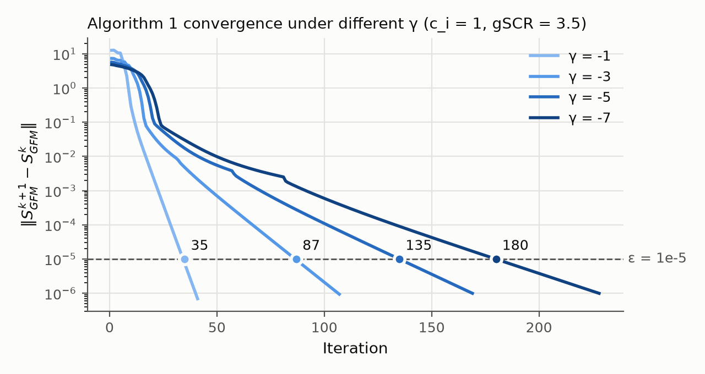
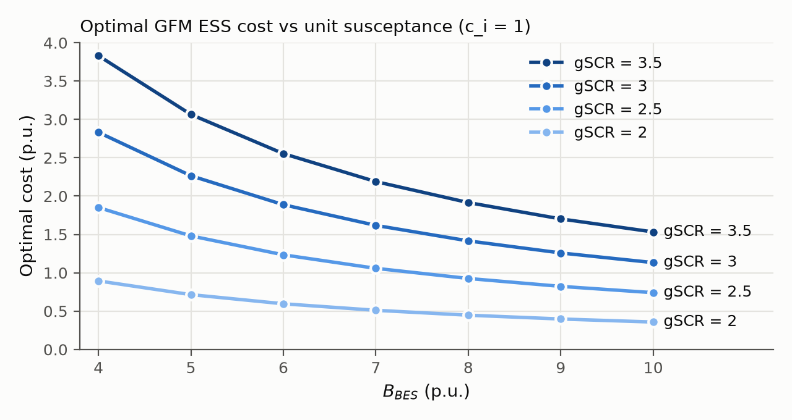
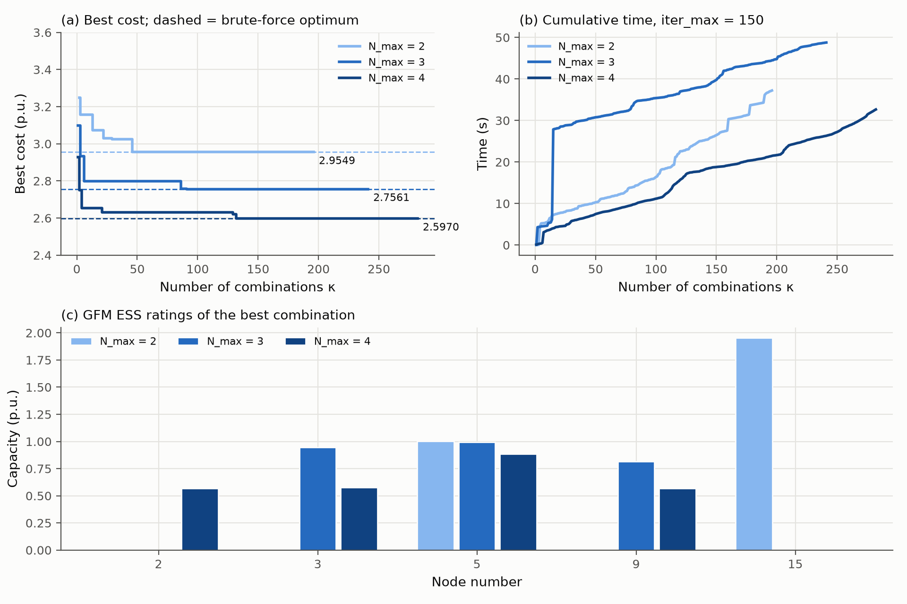
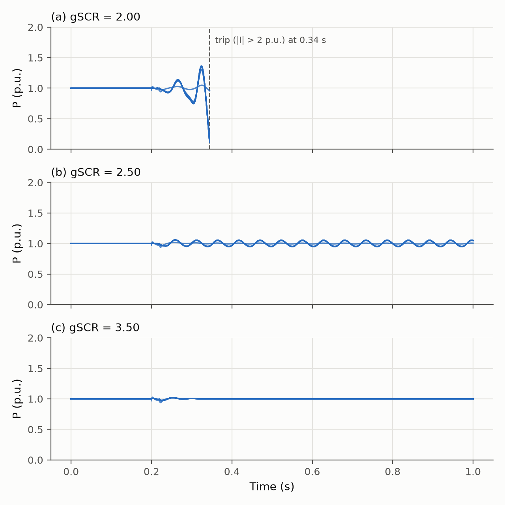
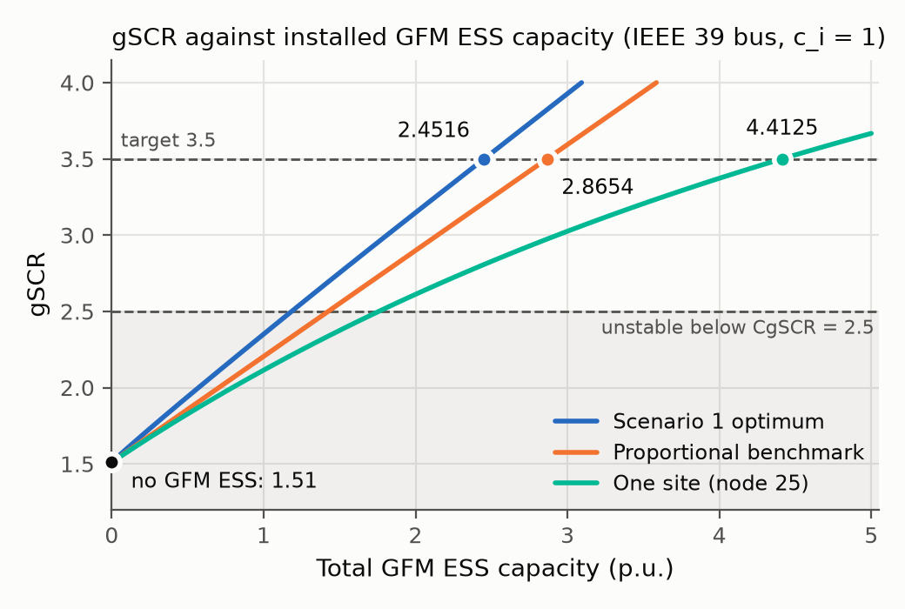
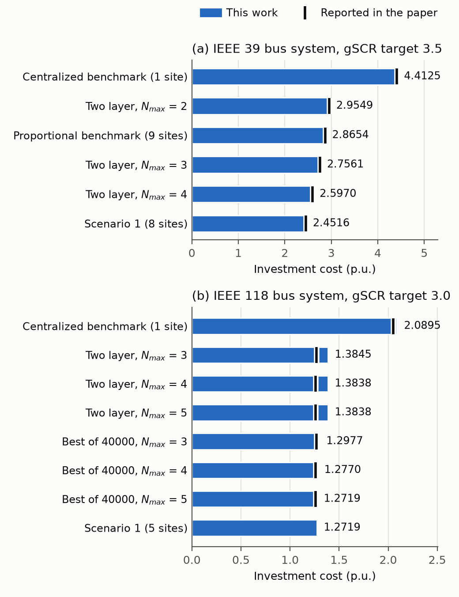

# Optimal GFM Placement

This project is a replication of the work presented in "System Strength Constrained Grid-Forming Energy Storage Planning in Renewable Power Systems" [1]. The paper studies the optimal placement and sizing of grid-forming energy storage systems under system strength constraints in renewable power systems.

Course project for NCSU ECE 572, Optimization and Algorithms. Everything is implemented from scratch in Python.

## Problem

Grid-following (GFL) inverter-based resources become unstable on weak grids. The paper measures grid strength with the **generalized short-circuit ratio**,

$$\text{gSCR} = \lambda_{\min}\left(S_{GFL}^{-1} B_{red}(S_{GFM})\right),$$

where $B_{red}$ is the Kron-reduced network susceptance matrix at the GFL nodes. Each grid-forming (GFM) energy storage system of rating $S_{GFM,i}$ adds a shunt susceptance $B_{BES} S_{GFM,i}$ to the network. The planning problem is

$$\min_{S_{GFM}} \sum_i c_i S_{GFM,i} \quad \text{s.t.} \quad \text{gSCR}(S_{GFM}) \ge \text{CgSCR} + \Delta g_0,\quad S_{min} \le S_{GFM,i} \le S_{max},$$

in two scenarios:

- **Scenario 1** allows a GFM at any site.
- **Scenario 2** allows at most $N_{max}$ sites, which makes it a mixed-integer problem.

## What is implemented

| Paper component | Module |
|---|---|
| Modified IEEE 39-bus and 118-bus systems | `network/load_system.py` |
| Susceptance matrix, GFM shunt model, Kron reduction (Eqs. 3–9) | `network/build_B_matrix.py`, `network/kron_reduction.py` |
| gSCR (Eq. 13), analytic gradient (Eqs. 22–23), site sensitivity (Eq. 27) | `stability/calculate_gscr.py`, `stability/sensitivity.py` |
| Scenario 1: Algorithm 1 (support-function SOCP iterations), plus an exact SDP reference | `optimization/scenario1.py` |
| Scenario 2: two-layer method (sensitivity-ranked enumeration + Algorithm 1), brute force | `optimization/scenario2.py` |
| GFL converter model, critical gSCR, multi-infeed modal and time-domain validation | `stability/gfl_model.py`, `validation/dynamic_simulation.py` |
| One script per figure or table | `experiments/` |

**Beyond the paper**, we also:

- **Solve Scenario 1 to global optimality.** The gSCR constraint is equivalent to a linear matrix inequality, so Scenario 1 is a convex SDP. We solve it and use it to certify Algorithm 1.
- **Make Algorithm 1 more robust** with an adaptive-γ safeguard.
- **Brute-force Scenario 2** on the 39-bus system (up to 73,815 combinations) to confirm the global optimum.
- **Sweep the closed-loop modes** of the planned multi-infeed system across planned gSCR values.

## Results

### IEEE 39-bus system: reproduced

| Quantity | This replication | Paper |
|---|---|---|
| Baseline gSCR | 1.5101 | 1.51 |
| Table II, sensitivity ranking | identical (12 nodes, 4 decimals) | — |
| Table I, Scenario 1 cost (c_i = 1) | 2.4516 at nodes 1–7, 9 | 2.4516 at nodes 1–7, 9 |
| Table I, Scenario 1 cost (c_i = 0.9 interior) | 2.4202 | 2.4203 |
| Table III, Scenario 2 cost, N_max = 2 / 3 / 4 | 2.9549 / 2.7561 / 2.5970 | 2.9549 / 2.7561 / 2.5970 |
| N_max = 4 optimum found at combination | #132 | #132 |
| Centralized benchmark | 4.4125 (node 25) | 4.4125 (node 25) |

- **Global optimality.** Algorithm 1 agrees with the exact SDP to 1e-8.
- **Scenario 2.** The two-layer method finds the brute-force global optimum for every N_max.

<p align="center">
  
  
</p>

<p align="center">
  
</p>

### Dynamic validation (Fig. 8): reproduced qualitatively

The paper does not give the GFL controller, so we designed one. It has PI current control, an SRF-PLL and outer power and voltage loops, and it is tuned so that the single-infeed critical gSCR is 2.50, as in the paper.

The planned nine-GFL system loses stability exactly when the planned gSCR falls below 2.499. This confirms the paper's claim that gSCR above the critical gSCR means small-signal stability.

<p align="center">
  
</p>

### IEEE 118-bus system (Table IV): not reproduced

| Quantity | This replication | Paper |
|---|---|---|
| Baseline gSCR | 1.6055 | 1.69 |
| Centralized benchmark | 2.0895 | 2.0522 |
| Best of 40,000 combinations, N_max = 3 / 4 / 5 | 1.2977 / 1.2770 / 1.2719 | 1.2681 / 1.2615 / 1.2605 |
| Two-layer, N_max = 3 / 4 / 5 | 1.3845 / 1.3838 / 1.3838 | 1.2681 / 1.2615 / 1.2615 |

- **The paper's 118-bus network data must differ from ours.** Our certified Scenario 1 optimum, which has *no* limit on the number of sites, is 1.2719. Limiting the number of sites can only raise the cost, yet the paper reports 1.2681 with only 3 sites. That is impossible on identical data. The paper does not publish its modified 118-bus data.
- **The paper's own cited data source gives our network.** The IIT JEAS_IEEE118 line table the paper cites is identical to MATPOWER `case118`. `experiments/ieee118_data_checks.py` also tests resistance, tap ratios, shunts, line charging, uniform scaling, other SG locations and single-branch changes. Some variants reproduce the 1.69 baseline, but none reproduces the baseline, the centralized benchmark and the Scenario 1 cost together.
- **The two-layer method stops early on our data.** Its stopping rule halts before it reaches the 40,000-combination reference result.

### Overview figures (not in the paper)

<p align="center">
  
  
</p>

The left figure shows the gSCR reached per p.u. of installed GFM capacity for three placements: the Scenario 1 optimum, the proportional benchmark and a single site. The right figure compares the cost of every plan and benchmark on both systems with the paper's reported values.

## Assumptions and differences from the paper

- **Network:** purely inductive, as in the paper.
  - The 39-bus reactances are scaled by 1.5.
  - The 118-bus data is standard MATPOWER `case118`, unscaled.
  - Synchronous generators are ideal voltage sources.
- **Ratings:** B_BES = 6.25 p.u.
- **Targets:** gSCR ≥ 3.5 (39-bus) and ≥ 3.0 (118-bus).
- **Not given in the paper**, so chosen by us:
  - S_min = 0 and S_max = 10 p.u. (S_max is never binding);
  - Algorithm 1 starts from S = S_max;
  - the GFL controller and its gains;
  - a 0.05 p.u. sag depth for Fig. 8.
- **Algorithm 1:** γ = −1, as in the paper, does not strictly satisfy the paper's convergence condition (Eq. 24) on this system. We added an adaptive-γ safeguard. Fig. 6 uses the paper's fixed-γ version.
- **Table III:** combination counts differ by one from the paper's, a counting convention in the stopping rule (Eq. 29).

[`HANDOVER.md`](HANDOVER.md) has the full details: modelling choices, solver design, a point-by-point comparison with the paper, and notes for the report.

## Repository structure

```
├── README.md, HANDOVER.md, requirements.txt
└── gfm_planning_replication/
    ├── data/           branch tables of the modified IEEE 39- and 118-bus systems, IIT 118-bus line table
    ├── network/        system loading, susceptance matrix, Kron reduction
    ├── stability/      gSCR, sensitivities, GFL converter model
    ├── optimization/   Scenario 1 (Algorithm 1, SDP) and Scenario 2 (two-layer)
    ├── validation/     multi-infeed modal and time-domain simulation
    ├── experiments/    scripts that reproduce the paper's figures and tables
    └── results/        generated figures (PNG) and data tables (CSV)
```

## Getting started

Requires Python 3.12 or later; developed on 3.14 with the pinned versions in `requirements.txt`.

```bash
python -m venv .venv
source .venv/bin/activate          # Windows: .venv\Scripts\activate
pip install -r requirements.txt
cd gfm_planning_replication
pip install -e .
```

Run all commands from `gfm_planning_replication/`:

| Command | Reproduces | Run time |
|---|---|---|
| `python -m stability.calculate_gscr` | baseline gSCR | seconds |
| `python -m stability.sensitivity` | gradient check, Table II | seconds |
| `python -m optimization.scenario1` | Table I | seconds |
| `python -m experiments.reproduce_fig6_fig7` | Figs. 6 and 7 | ~15 s |
| `python -m experiments.brute_force_scenario2 N_MAX [WORKERS]` | brute-force reference for N_max = 2, 3, 4 | up to ~25 min |
| `python -m experiments.reproduce_fig9` | Table III, Fig. 9 | ~2 min |
| `python -m experiments.reproduce_fig8` | Fig. 8, gSCR stability sweep | ~5 s |
| `python -m experiments.reproduce_table4 --top 40000 --workers 6` | Table IV | ~1 h |
| `python -m experiments.report_figures` | overview figures (needs the Table III and IV CSVs) | ~6 s |
| `python -m experiments.ieee118_data_checks [--scan]` | 118-bus data-variant checks | ~5 min, longer with `--scan` |

The long runs write their results to CSV as they go and resume where they stopped if interrupted. All outputs are already included in `results/`.

The branch tables in `data/` were exported from [ANDES](https://github.com/CURENT/andes) test cases with `python -m network.load_system`. ANDES is only needed to regenerate them.

## Reference

[1] Y. Liu, Y. Chen, H. Xin, J. Tu, L. Zhang, M. Song, and J. Zhu, "System Strength Constrained Grid-Forming Energy Storage Planning in Renewable Power Systems," *IEEE Transactions on Sustainable Energy*, vol. 16, no. 2, pp. 981-994, Apr. 2025, doi: [10.1109/TSTE.2024.3494259](https://doi.org/10.1109/TSTE.2024.3494259).
